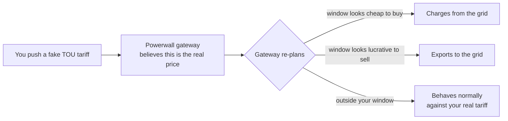

# Powerwall TOU Control

Teach a Tesla Powerwall to charge from the grid, or to export to the grid, on
your own schedule — not the schedule it would otherwise plan for itself.

## The big idea, in four sentences

A Tesla Powerwall does not have a "charge now" or "export now" button in its
API. Instead, in its automatic mode it looks at the tariff (the "time of use",
or TOU, price schedule) it believes you are on, and plans its own behaviour
around getting you the cheapest electricity. If you push it a fake tariff —
one where, say, the next two hours are absurdly cheap to buy and everything
else is expensive — the Powerwall will happily "optimise" itself into
charging during exactly the window you chose. This repository is a set of
docs, Home Assistant examples, and hard-won lessons for doing that safely and
reliably.

## Who this is for

Someone who already has a working Home Assistant setup and a Tesla Powerwall,
and wants to force a charge or export window on demand — for example, to use
a one-off cheap electricity period, or to export during a short high
sell-price window, without waiting for the Powerwall's own planner to notice.

You should be comfortable editing YAML and reasonably confident with Home
Assistant automations. This is not a beginner Home Assistant tutorial, but it
does explain every piece of jargon the first time it comes up, because the
Powerwall/Tesla side of this is obscure even to experienced users.

## What you need

- A Tesla Powerwall 2 or Powerwall 3 (or later — the principle is the same,
  but check your own gateway firmware behaves the way this repo describes
  before relying on it).
- Home Assistant.
- The [Teslemetry](https://teslemetry.com/) integration, which is what this
  repo's examples are built on. It is a paid cloud service that proxies
  commands to the Tesla Fleet API, including the `time_of_use` call that
  pushes a fake tariff.
- Optionally, the core `powerwall` integration for a local (LAN) connection
  to your gateway. This gives you fast, ~30-second sensors, which matter a
  lot — see [docs/05-lessons-learned.md](docs/05-lessons-learned.md).

Other integrations (for example a different Tesla cloud integration, or a
community fork) may expose the same underlying API slightly differently.
The ideas here — fake tariffs, ordering, verification, rate limits — apply
regardless of integration, but check your own entity and service names.

## Map of the docs

| Doc | What's in it |
|---|---|
| [docs/01-the-big-idea.md](docs/01-the-big-idea.md) | Why there's no "charge now" button, the four levers you actually have, a glossary |
| [docs/02-anatomy-of-a-tariff.md](docs/02-anatomy-of-a-tariff.md) | The `tou_settings` JSON field by field, the "isolated spike" trick, the midnight-wrap gotcha |
| [docs/03-recipes.md](docs/03-recipes.md) | Four ready-to-use recipes: force charge, force export, hold, back to normal |
| [docs/04-home-assistant-setup.md](docs/04-home-assistant-setup.md) | Installing Teslemetry, finding your entity ids, sign conventions, helpers |
| [docs/05-lessons-learned.md](docs/05-lessons-learned.md) | The most important doc — everything that went wrong building this, generalised |
| [docs/06-troubleshooting.md](docs/06-troubleshooting.md) | Symptom → likely cause → fix, as a quick-reference table |
| [docs/07-octopus-integration.md](docs/07-octopus-integration.md) | Combining this with the Octopus Energy integration: dispatches, Saving Sessions, Power Ups, Agile |
| [examples/home-assistant/](examples/home-assistant/) | Working YAML: helpers, a reusable push script, a "back to normal" script, a controller automation, a dashboard card |
| [examples/home-assistant/octopus/](examples/home-assistant/octopus/) | Octopus-specific automations and a safe-write script |
| [examples/tariffs/](examples/tariffs/) | Plain JSON examples of the tariff payload, for anyone not using Home Assistant |

## Disclaimer — please read this

This project is **not affiliated with, endorsed by, or supported by Tesla**
in any way. It describes behaviour of an undocumented, unofficial API that
Tesla could change or remove at any time, without notice.

**You use everything in this repository entirely at your own risk.** Pushing
a fake tariff changes how your Powerwall behaves, including when it imports
from and exports to the grid. Before you export any power at all, **check
with your electricity network operator and your electricity supplier** that
you are permitted to export, and find out your export limit. Exporting
without permission, or above your permitted limit, may breach your
connection agreement or your supplier's terms.

**You are responsible for any costs this causes** — including, but not
limited to, importing electricity at a peak rate, exporting at a rate you
didn't intend, battery wear, or any charges your network operator or
supplier applies. Nothing here is financial, legal, or electrical safety
advice. Test cautiously, verify everything, and don't leave automations
unattended until you trust them.

## Licence

Released under the [MIT licence](LICENSE) — copyright 2026 Craig Rouse. Do
what you like with it, including modifying it and using it commercially, but
it comes with no warranty at all (see the disclaimer above, which applies
regardless of the licence).
